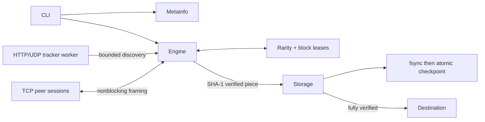

# Design and correctness

## One owner for transfer state

The main downloader uses `selectors` and nonblocking sockets, rather than one
thread per peer. `Engine` alone owns sessions, leases, the scheduler, counters and
storage. This makes release/accept/cancel/commit transitions sequential and avoids
cross-thread races. `PeerConnection` retains the small synchronous diagnostic /
single-piece API. One independent tracker I/O thread reports through a one-slot
queue. Protocol logic is implemented here; libtorrent is used only by the
independent interoperability harness.

## Scheduling and ownership

An absent bitfield starts with **empty** availability. A first-message bitfield
must have exactly ceil(N/8) bytes and zero padding. HAVE adds one valid index;
joining/disconnecting updates counts. New work chooses the fewest connected
sources, preferring an already allocated buffer on equal rarity, then a seeded
random rank. The experimental sequential policy uses ascending piece indices but
still respects availability and leases. It is a comparable basic policy, not the
original queue implementation.

Blocks are `(piece, offset, exact_length)` leases. Normal operation allows one
owner. Choke or disconnect releases outstanding leases while retaining accepted
blocks. Request expiry drops a stalled connection, releasing all its work. If
active buffers are full, an unowned buffer with no connected source can be evicted;
its lost blocks return to the remaining count. Corrupt complete buffers are reset.
Mixed-source corruption does not identify a faulty peer, so the failed piece is
retried entirely from one source. A disconnect discards that retry's partial blocks
to preserve attribution. A single-source hash failure causes exponential cooldown
and bounded attempts; healthy contributors to mixed failures keep their retry
budgets. Counters and bounded per-peer failure reasons expose these decisions.

Endgame begins only below the configured remaining-block threshold **and** when
every remaining block is already leased. At most two peers own a block. The first
valid response releases both leases and queues CANCEL for the loser. Recent exact
requests are retained in a bounded per-session history for one request-timeout
period; matching late replies after cancel/choke are discarded and counted. A
malformed or unsolicited block fails the session. Evicted/expired history cannot
authorize arbitrary bytes. A final queued cancel is sent best-effort before close;
transport delivery is not guaranteed.

Invariants enforced in code/tests:

- No completed piece before mandated v1 SHA-1 validation; Storage independently
  validates again before accepting a commit.
- Commit-once verified set; endgame late replies cannot commit again.
- Block lengths/offsets and storage spans are checked before copying/writing.
- Leases are released on choke, timeout, cancellation and disconnect.
- Pending work, piece buffers, socket frames, outgoing messages, discovery and
  failure history have explicit bounds.

## Resource model and deadlines

Defaults: 8 connections, 5 requests/peer, 128 global leases, 8 active buffers,
64 MiB active payload budget, 256 discovered addresses, 32 open staging payload
handles (LRU), and one tracker result. The disk-write backlog is **zero**: synchronous
commit applies immediate backpressure. There is no disk worker queue to configure;
adding one would increase memory and complicate durability/shutdown. Whole file
payloads never accumulate in the engine's RAM. Test/benchmark peers do hold generated
payloads, and retained RSS measures the entire harness explicitly.

An active piece costs its declared size plus per-block metadata. The effective
active cap is min(max_active, floor(buffer_budget/piece_length)). There can be
additional temporary framing/copy/hash buffers: each session holds a partial
bounded frame plus up to a 64 KiB read, a 64 KiB outgoing hard cap and bounded recent
history. Exact RSS exceeds the payload budget. Metainfo <=8 MiB, depth <=64, files
<=10,000, path depth <=64, piece size <=16 MiB, tracker body <=1 MiB, trackers <=128.
Piece hashes, rarity counts/ranks and verified state cost O(N); availability costs
O(connected_peers * N), with Python set/integer overhead. The budget does not bound
this unavoidable metadata or interpreter/OS buffers.

Connect and handshake have separate monotonic deadlines. A pending block has a
request deadline. A peer's inactivity timer advances only on its first accepted
block (initial handshake establishes the timer); keepalive/HAVE/duplicates do not
extend it. The swarm deadline advances only on a verified disk commitment, so even
an endless source of corrupt pieces cannot run forever. Defaults are 5/5/10/20/60
seconds respectively. A legitimate very large/slow piece may require larger
deadlines. Ctrl+C sets a cooperative stop event; the reactor polls within 50 ms and
closes all peer sockets. A currently executing hash/fsync must finish first: no
hard wall-time guarantee is possible for a blocked filesystem operation.

Tracker responses have total elapsed-time checks in addition to socket timeouts.
UDP polls cancellation every 200 ms; its 15*2^n retry schedule is tested with a fake
clock and a connection ID expires after 60 seconds. An operation budget can abort
before the next protocol retry; it never retransmits early. DNS and blocking HTTP
connect/read can outlive cooperative cancellation. The tracker thread's final join
is capped at two seconds and it is a daemon; under a hostile resolver/tracker it may
still be finishing I/O after the API returns. The join limit bounds the main thread's wait, rather than
guaranteeing worker termination. Asynchronous DNS/HTTP or a discovery subprocess
would be needed to terminate pending tracker operations within a strict deadline.

## Resume and publication

`OUTPUT.newtorrent/identity.json` is immutable versioned identity: info hash, file
layout, piece length, absolute destination and staging path. Missing/truncated or
mismatched identity is rejected; use a fresh output to recover manually. Mutable
`checkpoint.json` includes verified indices. On restart it is treated only as a
hint: **all** relevant staging bytes are read and hashed. Corrupt/stale checkpoint,
missing payloads, truncated files and external edits do not turn into trusted
completion. A full-piece read buffer is the maximum revalidation payload in RAM.

Each commit writes every intersecting file span, flushes/fsyncs those payload
handles, then fsyncs a temporary checkpoint and atomically replaces it. POSIX also
fsyncs the staging directory. A crash between these steps can lose checkpoint
information but disk revalidation can recover the piece. Windows lacks this
directory-fsync primitive; filesystem/device power-loss durability is not proven.
The immutable identity is published before payload creation. Crashes in that small
initial identity-publication window require a fresh staging location. Verified
progress survives interruption; incomplete buffers are intentionally re-downloaded.

The sibling `.newtorrent.lock` uses flock on POSIX and a one-byte msvcrt lock on
Windows. The OS releases it on exit/kill. The stable lock file is intentionally
retained, even on success; deleting it could let another process lock a different
inode. These guarantees require a local filesystem honoring kernel locks. Network
filesystem behavior is unverified.

Multi-file bytes form the BEP 3 concatenation; zero-length entries exist physically,
and pieces may span arbitrarily many files. Binary-search lookup finds the first
intersecting span, and the 32-handle cache avoids repeatedly opening payload files.
Unsafe UTF-8 path components, traversal, absolute/drive paths, separators, Windows
reserved names, case-insensitive duplicates and file/directory conflicts are
rejected. Every actual path's ancestors are checked for symlinks/reparse points.
The output directory must be under the user's control; these checks do not defend
against a hostile local process racing path replacement. Hardlink attacks in an
externally writable staging directory are outside the threat model.

Single-file publication without overwrite uses atomic no-clobber hardlink creation
then unlinks staging, on a filesystem supporting hardlinks. `--overwrite` uses a
same-volume atomic replace. Failed transfers preserve an existing completed file.
Multi-file publication renames one isolated complete directory to a **fresh**
destination; existing directories are always refused. This publishes one directory,
not a sequence of per-file renames. Same-filesystem directory rename is the visibility
primitive; Windows/POSIX collision differences and external races mean it is not a
transaction over an existing directory. Concurrent unrelated local writers must
not create the destination during publication. Staging cleanup after a successful
rename is separate; a crash there can leave stale metadata, while the completed
destination remains valid.

## Protocol support

HTTP(S) compact IPv4 and numeric IPv4 dictionary peers, BEP 12 shuffled tiers with
successful tracker promotion, UDP connect/announce and periodic/lifecycle events
are supported. Counters announce received payload bytes (including duplicates),
uploaded=0 and left based on verified pieces. Each transfer has a unique 20-byte ID.
The advertised 6881 port is compatibility metadata: **there is no listener or
uploading**, so the client is downloader-only and does not imply inbound reachability.
Dictionary hostname peers, IPv6, UDP scrape, tracker redirects/compression, protocol
extensions (including fast/extension negotiation), DHT, magnets, v2 and encrypted
transport remain unsupported. Extension bits are not advertised.

Sources: [BEP 3](https://www.bittorrent.org/beps/bep_0003.html),
[BEP 12](https://www.bittorrent.org/beps/bep_0012.html),
[BEP 15](https://www.bittorrent.org/beps/bep_0015.html),
[BEP 23](https://www.bittorrent.org/beps/bep_0023.html).
